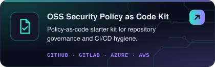
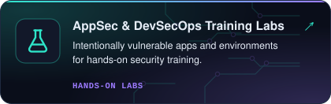
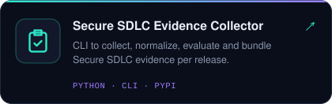
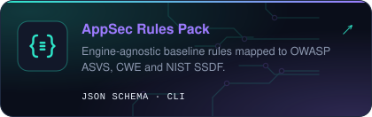
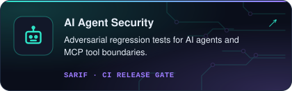
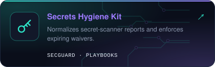
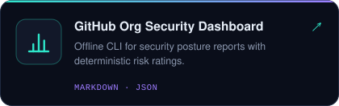
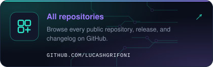
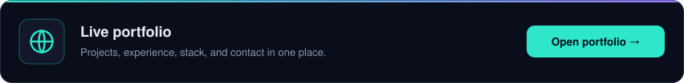

  

  <h1 align="center">Lucas Henrique Grifoni</h1>
  <h2 align="center">Application Security Specialist | DevSecOps Engineer | Product Security</h2>

  

  

  
  
  
  

## 👋 About Me:

I am an application security specialist and DevSecOps engineer with over 6 years of experience integrating security into software development lifecycles without compromising agility. I provide security controls across the SDLC and CI/CD pipelines, reducing risk through automation, secure design, and proactive threat mitigation.

I work directly with development, architecture, infrastructure, and product teams to embed security directly into the SDLC and CI/CD through automation and protections aligned with business objectives. My approach focuses on risk-based decisions, creating controls that reduce exposure upfront and help teams deliver faster, enabling security to be an accelerator rather than a blocker.

I have led and implemented application security and DevSecOps strategies in the financial, aviation, telecommunications, and healthcare industries, translating security requirements into practical solutions that strengthen the delivery of resilient, scalable, and reliable products.

## My motto is: Security as an accelerator and business partner, not a blocker/impediment.

## 🚀 Projects:

Open source tools I build for AppSec and DevSecOps teams. Each card opens the repository.

  
  
  
  
  
  
  
  

  

---

  <strong style="font-size: 1.8em; font-family: -apple-system, BlinkMacSystemFont, 'Segoe UI', 'Roboto', 'Oxygen', 'Ubuntu', 'Cantarell', 'Fira Sans', 'Droid Sans', 'Helvetica Neue', sans-serif; font-weight: 700; letter-spacing: 0.5px;">Where You Can Find Me</strong>

  

  

  

  

  <strong style="font-size: 1.2em; font-family: -apple-system, BlinkMacSystemFont, 'Segoe UI', 'Roboto', 'Oxygen', 'Ubuntu', 'Cantarell', 'Fira Sans', 'Droid Sans', 'Helvetica Neue', sans-serif; font-weight: 700; letter-spacing: 0.5px;">Built with focus on security, automation, and impact.</strong>

  

